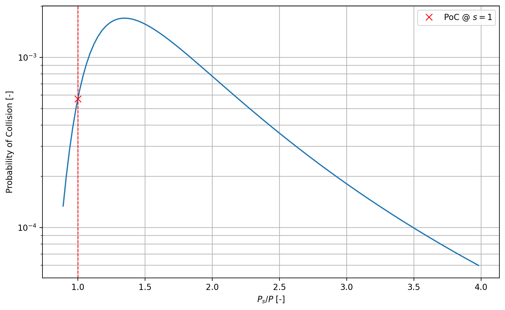
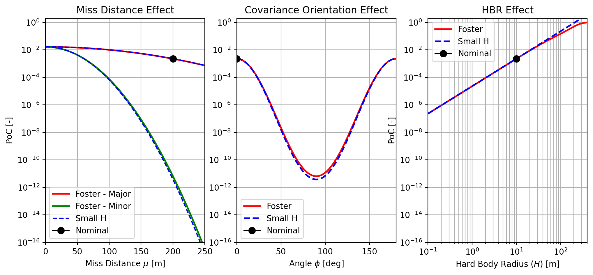
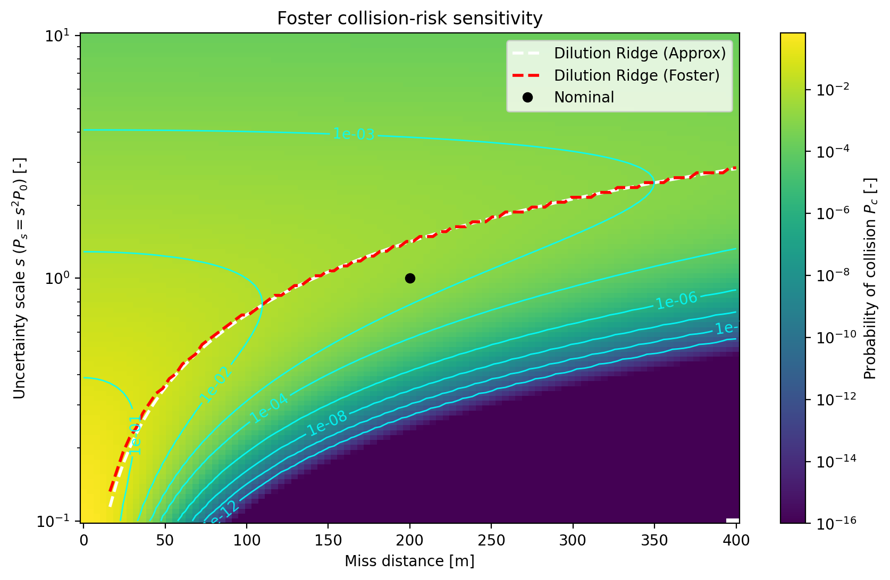

# Conjunction Risk Toolkit

A hands-on Python toolkit for modelling spacecraft conjunction geometry, uncertainty and collision probability at the time of closest approach.

The project develops the core mathematical pipeline used in space traffic management—from Cartesian states and RTN covariances to encounter-plane probability of collision.


## What it does

The toolkit currently supports:

- relative position, velocity, miss distance and range rate;
- RTN and encounter-frame construction;
- covariance transformation, combination and projection;
- two-dimensional covariance ellipses;
- circular hard-body regions;
- Foster collision-probability integration;
- Monte Carlo probability estimation;
- collision-risk sensitivity and probability-dilution analysis.

## Example conjunction

The included synthetic encounter has:

- a nominal miss distance of **200 m**;
- a relative speed of approximately **7.5 km/s**;
- a combined hard-body radius of **10 m**.

The calculated collision probabilities are:

| Method | Probability of collision |
|---|---:|
| Foster integration | `5.70218e-04` |
| Monte Carlo | `5.66320e-04` |

The Monte Carlo result agrees with the deterministic Foster calculation within `1.64` sampling standard deviations.

## Probability dilution

Collision probability is not necessarily monotonic with uncertainty.

As the covariance initially grows, more probability density overlaps the hard-body region and the probability of collision increases. After reaching a maximum, the density becomes increasingly dispersed and the calculated probability decreases.



This decrease does not imply that the encounter has become safer—it is a consequence of greater uncertainty.

## Risk sensitivity

Controlled numerical experiments explore how collision probability changes with:

- miss-distance magnitude and direction;
- covariance orientation;
- Hard-Body Radius;
- covariance magnitude.

The exact Foster calculation is compared with the small-HBR analytical approximation to identify where the approximation is valid and where it breaks down.



The coupled map below shows collision probability as a function of miss distance and covariance scale. The dilution ridge identifies the covariance scale that maximises collision probability for each miss distance.



Iso-probability contours demonstrate that the same collision probability can occur on either side of the ridge: once with relatively small uncertainty and once after probability dilution. These cases have very different operational interpretations despite sharing the same numerical \(P_c\).

## Quick start

Create and activate the Conda environment:

```bash
conda env create -f environment.yml
conda activate conjunction-toolkit
```

Install the package in editable mode:

```bash
python -m pip install -e .
```

Run the complete test suite:

```bash
pytest
```

Run the collision-probability example:

```bash
python examples/m3_collision_probability.py
```

## Project structure

```text
conjunction-risk-toolkit/
├── examples/                 # Executable conjunction studies
├── src/conjunction_toolkit/  # Geometry, covariance and probability tools
├── tests/                    # Automated verification
├── docs/images/              # README figures
├── environment.yml
└── pyproject.toml
```

## Scope

The current model assumes:

- a Gaussian relative-position distribution;
- independent object estimates;
- states and covariances defined at a common TCA;
- a short, linear encounter;
- a circular combined hard-body region.

The toolkit is an educational and portfolio implementation of conjunction-analysis fundamentals, not an operational collision-avoidance system.

## Progress

- [x] Relative conjunction geometry
- [x] Covariance transformation and encounter-plane projection
- [x] Foster and Monte Carlo collision probability
- [x] Probability-dilution and risk-sensitivity analysis
- [ ] CCSDS Conjunction Data Message support
- [ ] Manoeuvre sensitivity and CAM design
- [ ] Nonlinear post-manoeuvre verification